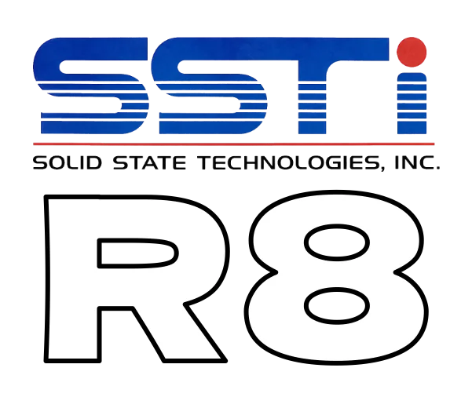

# awesome-r8

Resources for the [R8](https://bitfieldconsulting.com/r8-cpu) retro CPU architecture, a fantasy fan-fiction chip from an alternate 1976.

## Documentation

* [The R8 CPU](https://bitfieldconsulting.com/r8-cpu) — official information hub
* [R8 Programmer's Manual](https://bitfieldconsulting.com/books/r8-prog-manual) — manufacturer's databook (1976)
* [R8 Opcodes](https://bitfieldconsulting.com/r8-opcodes) — quick reference opcode table

## Tutorials

* [Emergency in space](https://bitfieldconsulting.com/posts/welcome-to-machine) — a guided introduction to building a high-level R8 emulator
* [go-machine](https://github.com/bitfield/go-machine) — Go solutions to the tutorial exercises
* [rust-machine](https://github.com/bitfield/rust-machine) — Rust solutions to the tutorial exercises
* [ts-r8-solutions](https://github.com/alvarezgarcia/ts-r8-solutions) — TypeScript solutions to the tutorial exercises

## Books

Books and other published resources on R8:

* _Welcome to the Machine_ (coming soon) — a complete guide to building an R8 emulator, with example code in both Go and Rust

## Emulators

There are a number of R8 emulators in various languages.

### Rust

* [RX82](https://github.com/bitfield/r8/tree/main/crates/rx82) — the official reference emulator, a low-level emulator for a 1982-style retro computer system based on the R8
* [rust-r8](https://github.com/bitfield/rust-r8) — a template repo for writing R8 emulators in Rust

### Go

* [gr8](https://github.com/bitfield/gr8) — a high-level R8 emulator
* [go-r8](https://github.com/bitfield/go-r8) — a template repo for writing R8 emulators in Go
* [go-r8](https://github.com/jgrecu/go-r8) — a high-level R8 emulator by Jeremy Grecu
* [go-r8](https://github.com/ezebunandu/go-r8) — an R8 emulator by Sam Ezebunandu

### TypeScript

* [ts-r8-emulator](https://github.com/alvarezgarcia/ts-r8-emulator) — a high-level R8 emulator by Sebastián Alvarez

### Hare

* [hare-r8](https://git.sr.ht/~whereiseveryone/hare-r8) — a Hare R8 emulator by Jorge Gomez.

### Common Lisp

* [jgart.r8](https://git.sr.ht/~whereiseveryone/jgart.r8) — another Hare R8 emulator by Jorge Gomez.

## Testing and validation

Test programs and suites for validating R8 emulators.

* [R8 functional tests](https://github.com/bitfield/r8/tree/main/crates/r8cpu/functional_tests) — a set of individual instruction and function tests, available as R8 binaries and as assembly-language source code

## Libraries

Software packages of interest to R8 emulator developers:

* [r8cpu](https://github.com/bitfield/r8/blob/main/crates/r8cpu) — core types for R8 emulators, such as registers, flags, and instruction kinds (Rust)

## Tools

Utilities for those writing R8 programs or implementations.

* [r8asm](https://github.com/bitfield/r8/tree/main/crates/r8asm) — an assembler / disassembler for R8

## Developer experience

Quality of life improvements for coding in R8 assembly language.

* [Kate/KDE syntax definition file](resources/r8asm.xml) for syntax-highlighting R8 assembly language in compatible editors, or HTML generators such as Pandoc
